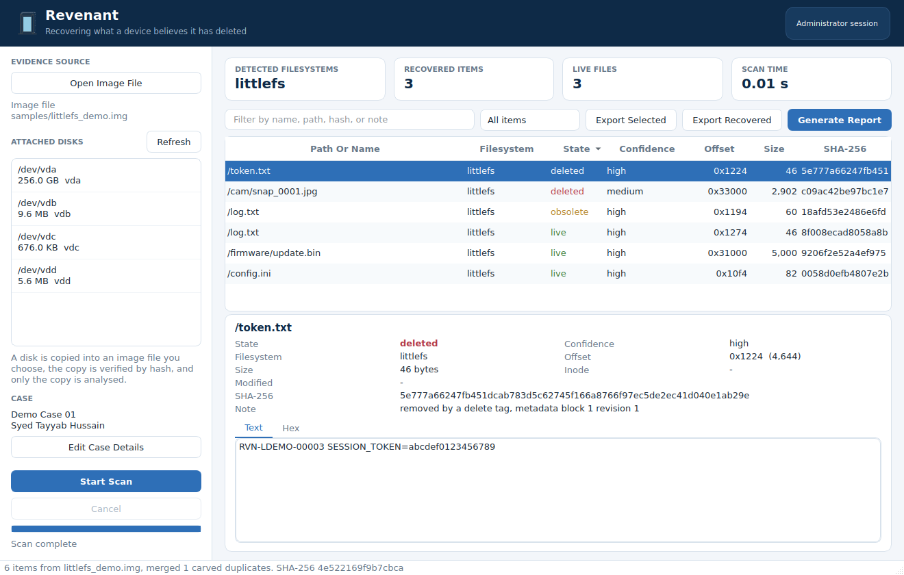

# Revenant

Revenant recovers data that a flash device still holds but no longer shows. On raw NAND and SPI NOR flash, filesystems such as JFFS2, UBIFS, YAFFS, LittleFS and SPIFFS write every change out of place, so deleted files and superseded versions stay physically present until garbage collection erases their blocks. The usual extraction tools (binwalk, ubi_reader, jefferson, yaffshiv) rebuild the live tree and stop there. Revenant parses the same structures, validates each record by its checksum, and lists what the live tree left behind, giving every item a state, a confidence level, and enough provenance to defend it in a report.

It is a desktop application for Windows and Linux that also runs on macOS, with a command line for scripted and headless work. The project is the MSc Cyber Security final project of Syed Tayyab Hussain at Arden University Study Centre Berlin.



## What it handles

| Filesystem | Where you meet it | What Revenant recovers | How far to trust it |
|---|---|---|---|
| LittleFS | SPI NOR on microcontrollers | Live, deleted and superseded files, inline and CTZ, plus data blocks no commit references any more | Scored against images made by the reference implementation, see the benchmark below |
| JFFS2 | Raw NAND and NOR on older embedded Linux | Every inode rebuilt by ordered replay, earlier versions, unlinked files | Scored on synthetic node logs, validate on nandsim images before relying on it |
| UBIFS | Raw NAND on current embedded Linux | Files per inode, stale block copies, unlinked inodes | Live status comes from sequence numbers rather than the on flash index |
| SPIFFS | SPI NOR on ESP32 and ESP8266 devices | Live and deleted files rebuilt by span, stray pages from earlier versions | Checked against images built by Espressif's spiffsgen |
| YAFFS2 | Raw NAND on older Android and embedded boards | Object headers, names, timestamps and deletion markers | No content reassembly, since that needs the spare area tags |
| Any image | Signature carving | PNG, JPEG, GIF, PDF, ZIP, gzip, xz, bzip2, SQLite, XML, ELF, RIFF and PEM, each cut at its true end where the format allows | Confidence says whether the end was validated or estimated |

Managed flash is out of scope on purpose. SSDs, eMMC, SD cards and USB sticks put a controller with its own translation layer between the host and the chips, and TRIM tells that controller to discard deleted data, so a logical image of those devices does not contain what Revenant looks for. Encrypted storage is out of scope for the same practical reason.

## Installing

You need Python 3.10 or newer. Development and testing used Python 3.12, which is the safest choice. The first launch creates a private environment in a `.venv` folder next to the code and downloads PySide6 and reportlab into it, which takes a few minutes on an ordinary connection and never touches your system Python.

On Windows, install Python from python.org and tick "Add python.exe to PATH" during setup. Unzip Revenant anywhere and double-click `run_windows.bat`. If you want to read attached disks, right-click the same file and choose "Run as administrator" instead, because Windows only lets elevated programs open raw drives.

On Debian or Ubuntu, install the venv module and the one Qt dependency that minimal systems tend to miss, then start the launcher from the Revenant folder.

```
sudo apt install python3 python3-venv libxcb-cursor0
./run_linux.sh
```

Fedora users need `sudo dnf install python3 xcb-util-cursor` instead. On macOS, install Python from python.org or Homebrew and double-click `run_macos.command`. Gatekeeper blocks unsigned scripts the first time, so right-click the file and choose Open once. If unzipping stripped the execute bit, run `chmod +x run_macos.command run_linux.sh` in a terminal.

To install by hand on any platform, create and activate a virtual environment, run `pip install -r requirements.txt`, and start the interface with `python -m revenant`. Running `pip install .` also works and adds two commands, `revenant` for the interface and `revenant-cli` for the command line.

LZO and zstd compressed JFFS2 or UBIFS nodes need the optional packages `python-lzo` and `zstandard`. Without them those nodes are reported as damaged rather than silently skipped, and zlib, rtime and uncompressed nodes work out of the box.

## Using the desktop app

Choose Open Image File for a flash dump (the file dialog accepts `.img`, `.bin`, `.dd`, `.raw`, `.dump` and `.nand`, and anything else through "All files"), or pick an attached disk from the list. Then press Start Scan. The scan runs on a worker thread, so the window stays responsive, and Cancel stops it cleanly and keeps whatever was found so far. The demo images in `samples` are a good first run, since each one has a truth file that says exactly what should come back.

The four cards at the top summarise the result, and the table lists every item with its path, filesystem, state, confidence, offset and size. Hovering over a row shows the parser's note for that item, and the filter box searches names, paths, hashes and notes at once. The drop-down narrows the table to one state, and "Recovered only" hides the live files. Selecting a row fills the lower pane with the item's metadata, its SHA-256, and two views of its content, a text view and a classic hex dump.

Export Selected writes the chosen rows, and Export Recovered writes everything that is not live. Each exported file is read back and hashed again after writing, and a `revenant_manifest.csv` records the original name, path, state, offset and both hashes. Generate Report asks for the case details if you have not entered them yet, then writes a PDF with the evidence hashes, a summary, every recovered item with a preview, and the audit trail of the session.

The keyboard shortcuts are Ctrl+O to open an image, Ctrl+Enter to scan, Ctrl+F to jump to the filter box, Ctrl+E to export the selection, and Ctrl+R to write the report.

### States and confidence

| State | Meaning |
|---|---|
| deleted | Removed from the filesystem, with its content still on flash |
| obsolete | An earlier version that a later write replaced |
| orphaned | Real data whose name and directory entry are gone, so it cannot be tied to a path |
| carved | Found by the signature carver with no filesystem context |
| live | Part of the current filesystem, listed for comparison |

High confidence means the structure and its checksums line up. Medium means the content looks complete but part of it could not be verified, and low means the item is partial, damaged, or probably overwritten. These labels were measured rather than assumed. Across 30 LittleFS benchmark images, all 1,043 high confidence remnants were byte exact, 1,561 of 1,598 medium ones were byte exact, and none of the 37 low confidence ones were exact. Nearly every medium miss was the correct beginning of a file whose later blocks had been reused.

## Scanning an attached device

Revenant never parses a device in place. When you pick a disk and press Start Scan, it asks where to save an image, copies the device into that new file while hashing it, hashes the written file again from disk, and only then analyses the copy. The report states whether the two hashes matched, and an existing file is never overwritten. A cancelled or failed copy is deleted, since an incomplete image would be misleading evidence.

Raw devices need administrator rights on every platform. On Windows that means starting the launcher with "Run as administrator". On Linux and macOS it is cleaner to acquire with the command line under sudo and then open the image in the interface without elevation, which keeps the whole graphical stack out of a root session.

```
sudo .venv/bin/python -m revenant.cli acquire /dev/mtd0 board_dump.img --scan --report reports
```

In practice most microcontroller flash reaches an examiner as a file rather than as a disk. SPI NOR chips are usually read with a programmer (`flashrom -p ch341a_spi -r dump.bin` is a common example), and Linux MTD partitions are dumped on the device itself. For NAND, dump the main area without the spare bytes, since spare bytes interleaved with the data break nodes that cross page boundaries. Recent mtd-utils versions of `nanddump` leave the spare area out unless you ask for it. When the medium is a USB reader and the evidence matters, put a hardware write blocker in the path, because Revenant opens everything read only but your operating system may still mount the device on its own.

## Command line

The command line exposes the same engine as the interface.

```
python -m revenant.cli disks
python -m revenant.cli scan samples/jffs2_demo.img --report out --json out/result.json --export out/files
python -m revenant.cli acquire /dev/mtd0 evidence.img --length 16777216 --scan --case "Case 7" --examiner "S. T. Hussain"
```

The `scan` and `acquire` commands accept `--case`, `--examiner`, `--reference` and `--notes` for the report header. `--export-all` exports live files too, `--limit` sets how many rows are printed, and `--no-hash` skips hashing the image first. Exit status is 0 on success and 2 on an error such as a missing image or a refused device, so scripts can check it.

## Running the tests

The tests need the development packages, which add pytest, littlefs-python, matplotlib and Pillow.

```
.venv/bin/python -m pip install -r requirements-dev.txt     # Windows: .venv\Scripts\python.exe
.venv/bin/python -m pytest
```

The suite has 52 tests and takes about two seconds. They check every demo image against its truth file at the byte level, confirm that a single flipped bit in a LittleFS commit or a JFFS2 header makes the parser reject that record, and replay JFFS2 truncation and hole cases. Other tests carve nine file formats at their exact ends, feed decompression bombs and path traversal names to the guardrails, verify that a scan never changes the evidence file, acquire a device-like file and check the hash verification, and drive the command line and an offscreen copy of the window. The UI test sets `QT_QPA_PLATFORM=offscreen` by itself, so it runs on machines with no display.

## Running the benchmarks

The benchmark measures two separate things. Survival asks whether a deleted or superseded version still physically exists in the image, and recovery asks whether Revenant found it. Every version of every file starts with a unique token, which lets both questions be answered exactly: survival by searching the raw image for the token, recovery by searching Revenant's output.

```
.venv/bin/python tools/run_benchmark.py --quick     # 3 seeds, about one second
.venv/bin/python tools/run_benchmark.py --samples   # the full default run, about 9 seconds
```

The full run builds 40 LittleFS images through the reference implementation (10 seeds at each of 0, 50, 200 and 800 later write operations), 10 synthetic JFFS2 node logs, and scores the four demo images. Results land in `bench_results`, with one row per image in `results.csv`, totals in `summary.json` and `summary.md`, the same data as a workbook in `revenant_benchmarks.xlsx`, and the figure `survival_vs_churn.png`. That folder is committed here, together with the 50 generated images and their truth files under `bench_results/images`, so the published numbers can be checked without regenerating anything, and a fresh run on a clean checkout should leave them unchanged. Useful options are `--seeds`, `--ops`, `--churn 0 100 400`, `--keep-images` to save every generated image with its truth file, and `--images FOLDER` to score your own images.

These are the numbers from the run that shipped with this version.

| Suite | Later writes | Remnant versions | Still on flash | Recall of surviving | Correct state | Byte exact | Path correct | Path correct where named | Live mount baseline |
|---|---|---|---|---|---|---|---|---|---|
| JFFS2 synthetic | 0 | 317 | 100% | 100% | 100% | 100% | 100% | 100% | 0% |
| LittleFS | 0 | 350 | 100% | 100% | 100% | 100% | 100% | 100% | 0% |
| LittleFS | 50 | 629 | 98.1% | 100% | 97.1% | 100% | 98.4% | 100% | 0% |
| LittleFS | 200 | 1,659 | 61.1% | 100% | 57.1% | 100% | 57.5% | 100% | 0% |
| LittleFS | 800 | 5,933 | 21.5% | 100% | 48.5% | 97.2% | 46.4% | 90.4% | 0% |

The falling "correct state" column is expected rather than a fault. Once compaction has erased every commit that named a file, its data blocks can still be rebuilt from their own skip list pointers, but nothing on flash says any more whether the file was deleted or replaced, so Revenant reports those items as orphaned instead of guessing. The live mount baseline is what you get from mounting each image with the reference implementation and reading every file, which is all a conventional extractor returns. The two path columns are worth reading together: when Revenant hands back a path it is almost always the right one, while how often any path survives to be recovered falls with churn, because compaction erases the directory entries before it erases the data.

JFFS2 and UBIFS need a Linux kernel to produce realistic images. `tools/nandsim_bench.sh` loads the kernel's NAND simulator, runs the same workload through the real filesystem driver, and dumps each image with its truth file. It was written against the documented tools but could not be executed in the build environment, which has no kernel module access, so run it on a disposable virtual machine first.

```
sudo tools/nandsim_bench.sh jffs2          # or ubifs, SEEDS=5 CHURNS="0 200" also work
python3 tools/run_benchmark.py --skip-synthetic --images nand_bench --out bench_results_nand
```

`docs/BENCHMARKS.md` explains the method, the metrics and the caveats in full, including why the script turns compression off by default.

## Rebuilding the demo images

`python tools/make_test_images.py` rebuilds the four images in `samples` together with their truth files. It needs the development packages, and the SPIFFS image comes from Espressif's spiffsgen, which ships unmodified in `tools/third_party`.

## Troubleshooting

If Qt reports that it could not load the "xcb" platform plugin on Linux, install `libxcb-cursor0` (Debian and Ubuntu) or `xcb-util-cursor` (Fedora). Qt 6.5 and later need it, and minimal installs leave it out.

A "Permission denied" message while scanning a disk means the session is not elevated. The chip in the top right corner of the window says which kind of session you are in.

If pip cannot find a PySide6 wheel, your Python is newer than the PySide6 release that pip picked, so either upgrade pip or use Python 3.12.

When a scan detects no filesystem, the image may come from managed flash, may be encrypted, or may be a NAND dump with spare bytes interleaved. The signature carver still runs on every image, so carved files can appear even when no filesystem is recognised.

## Project layout

```
revenant/core/               evidence handling, engine, report, export, guardrails
revenant/core/filesystems/   one carver per filesystem plus the signature carver
revenant/ui/                 the PySide6 interface
revenant/cli.py              the command line
tools/                       demo image builder, workload generator, benchmark, nandsim script
tests/                       the pytest suite
samples/                     demo images, truth files, and a sample report
bench_results/               the committed benchmark run, including every image it scored
docs/                        the documentation below
```

## Documentation

| File | What it covers |
|---|---|
| `docs/OVERVIEW.md` | What the tool is in plain language, what each file does, and how the pieces connect |
| `docs/USAGE.md` | Installing, every command line option with an example, the interface, and how to read the confidence labels |
| `docs/BENCHMARKS.md` | What is measured, how the images are built, the results, the CSV columns, and how to reproduce the run |
| `docs/DESIGN.md` | The design rules, the guardrails, and why each parser works the way it does |
| `docs/TOOL_COMPARISON.md` | How Revenant compares with binwalk, PhotoRec, Scalpel, The Sleuth Kit, FTK and EnCase |

## Known limits

The UBIFS carver does not rebuild the on flash index, so its live and obsolete labels are inferred from sequence numbers, and the numbers for JFFS2 and UBIFS come from synthetic node logs until the nandsim benches are run. YAFFS2 content cannot be tied to files without the spare area tags. For orphaned LittleFS chains the file length is no longer recorded anywhere, so the last block is cut where its erased space begins, and a file that genuinely ended in 0xFF bytes loses that tail. Images larger than 8 GiB are refused by design.

## License

MIT, see `LICENSE`. One third party component is vendored: `tools/third_party/spiffsgen.py` is Espressif's SPIFFS image generator from ESP-IDF under the Apache License 2.0, used unmodified to build test images.

## Credits

Revenant was written for Syed Tayyab Hussain's MSc Cyber Security final project at Arden University Study Centre Berlin. `tools/third_party/spiffsgen.py` is Espressif's SPIFFS image generator from ESP-IDF under the Apache License 2.0, used only to build test images. The LittleFS tests and benchmarks use littlefs-python, the Python binding of the reference littlefs implementation.
