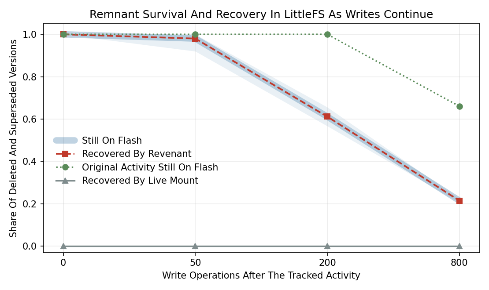

# How Revenant is benchmarked

The benchmark answers two questions that are easy to blur together. The first is whether a deleted or superseded version of a file still physically exists in a flash image, which depends on the filesystem and on how much writing happened afterwards. The second is whether Revenant found that version, which depends only on the tool. A tool cannot be blamed for data the flash already erased, so recovery is always reported as a share of what survived, and survival is reported separately.

## Ground truth by tokens

Every workload keeps a record of every version of every file it writes. Each version starts with a unique token such as `RVN-L0003-00017-5a1f09c2e4`, followed by filler text, and the truth file lists each version with its path, its final state, its size, and the SHA-256 of its exact bytes. A version's final state is live if it is the current content of an existing file, obsolete if a later write to the same path replaced it, and deleted if the file was removed.

Scoring then needs no trust in recovered names. A version survived if its token occurs anywhere in the raw image. It was found if its token occurs in an item Revenant returned with a matching kind, which means a live item for a live version and any non-live item for a deleted or obsolete one. It was labelled right if one of those items carries exactly the truth state, and it is byte exact if one of them hashes to the truth SHA-256. An item that is not live yet contains no token at all is counted as unattributed, since it cannot be tied to any real version.

Metadata accuracy is scored on top of that. A found remnant is path correct when one of the items carrying its token also carries the exact original path. Two figures come out of this. The first divides path correct remnants by every remnant found, so it falls as continued writing erases the directory entries that name a file. The second divides path correct remnants by the remnants that came back with any path at all, which is the honest reading of how often a recovered path can be trusted, since a remnant whose parent directory entry was itself erased is reported with no path rather than a guessed one.

## The suites

The LittleFS suite drives littlefs-python, the binding of the reference C implementation, with a configuration typical of SPI NOR parts: 4 KiB blocks, 128 blocks, 16 byte read and program sizes, a 256 byte cache, and a 16 byte lookahead. Each workload performs 60 tracked operations spread over the root, `/logs` and `/cfg`, choosing between creating a file, overwriting one, and deleting one, with 60 percent of files small enough to be stored inline in metadata and the rest between 600 and 6,000 bytes, stored as CTZ skip lists. A churn phase then performs further operations in `/noise`, and the suite repeats this for 10 seeds at 0, 50, 200 and 800 churn operations. Churn versions are tracked as well, and their tokens use the same scheme.

For comparison, every LittleFS image is also mounted with the reference implementation and every live file is read. That is the view a conventional extractor gives, and it is reported as the live mount baseline.

The JFFS2 suite writes node logs by hand, using the kernel's CRC convention, 4 KiB data nodes, zlib compression on some writes, truncation before each rewrite, and the obsolete marking the kernel applies on NOR flash. Nothing is ever garbage collected in these logs, so survival is complete by construction and the suite measures parsing alone. A realistic JFFS2 or UBIFS measurement needs the kernel, which is what the nandsim script is for.

## Results from the shipped run

| Suite | Later writes | Images | Remnant versions | Still on flash | Recall of surviving | Correct state | Byte exact | Path correct | Path correct where named | Live mount baseline | Unattributed |
|---|---|---|---|---|---|---|---|---|---|---|---|
| JFFS2 synthetic | 0 | 10 | 317 | 100% | 100% | 100% | 100% | 100% | 100% | 0% | 0 |
| LittleFS | 0 | 10 | 350 | 100% | 100% | 100% | 100% | 100% | 100% | 0% | 0 |
| LittleFS | 50 | 10 | 629 | 98.1% | 100% | 97.1% | 100% | 98.4% | 100% | 0% | 0 |
| LittleFS | 200 | 10 | 1,659 | 61.1% | 100% | 57.1% | 100% | 57.5% | 100% | 0% | 0 |
| LittleFS | 800 | 10 | 5,933 | 21.5% | 100% | 48.5% | 97.2% | 46.4% | 90.4% | 0% | 31 |
| Demo images | 0 | 4 | 9 | 100% | 100% | 100% | 100% | 100% | 100% | 0% | 0 |

Live files were recovered completely and byte exact in every suite. A 512 KiB LittleFS image scans in roughly 13 ms and the whole run finishes in about 11 seconds, though scan timings move with the machine, so the millisecond column in `summary.md` reflects whichever host produced that run. The two path columns are worth reading together. When Revenant hands back a path it is almost always the right one, at or near 100 percent until the heaviest churn and 90.4 percent even there. What falls with churn is how often any path survives to be recovered at all, since compaction erases the directory entries first and the file data later.



These numbers need some care to read, and the details below are the ones that matter most.

Survival falls quickly under churn, from 100 percent with no later writes to 21.5 percent after 800. The dotted curve in the figure shows something less obvious, though. Remnants of the original tracked activity survive completely up to 200 later writes and still stand at 66 percent after 800, far above the overall figure. LittleFS compacts metadata one directory pair at a time, so a directory that stays quiet keeps its commit history, while the busy `/noise` directory keeps overwriting its own. Data blocks come from one shared allocator, which is why even the quiet directories' larger files eventually lose ground. I did not expect the gap to be that wide, and it suggests that on a real device the age of a remnant says less about its survival than where it was written.

The share labelled with the correct state drops as survival drops, and this comes from a deliberate choice. After compaction has erased every commit that named a CTZ file, its data blocks can still be found and chained together from their own back pointers, and the extra skip pointers of each block confirm the chain. Nothing on flash records any more whether that file was deleted or merely replaced, so these items are reported as orphaned. Early versions of the parser missed them entirely, and recall at 800 later writes stood near 51 percent before chain recovery was added.

The 31 unattributed items at the heaviest churn are all low confidence. They are pieces of chains whose first blocks were reused, so they hold real file content without the token at its start. Across 30 images at 0, 200 and 800 later writes, every one of the 1,043 high confidence remnants was byte exact, 1,561 of the 1,598 medium ones were, and none of the 37 low ones were, which is the behaviour the labels promise.

## Running it yourself

`python tools/run_benchmark.py` runs the default suites, and `--quick` cuts it to three seeds at 0 and 200 later writes. `--seeds`, `--ops` and `--churn` change the design, `--keep-images` saves every generated image with its truth file so any single result can be inspected by hand, and `--samples` adds the demo images. Results go to `bench_results` unless `--out` says otherwise. That folder is committed to this repository, so a fresh run on a clean checkout should leave the numbers unchanged, which is the quickest way to confirm the build still reproduces them.

## Where the images come from

A recovery rate only means something against a known truth, and a real seized device does not arrive with a record of what was deleted. The benches therefore build their own images under a script that logs every file written, changed and deleted, then take the raw medium as a flat binary and ask the tool to bring the deletions back. The cost is that the images are synthetic rather than a real scene, which the caveats below state plainly. The gain is an exact ground truth, which is the only honest basis for a rate.

The LittleFS images are built by the real filesystem. The generator imports littlefs-python, a binding to the reference C implementation that runs on devices in the field, formats an image, and drives it through ordinary file calls. When LittleFS compacts a directory and erases the commit that named a deleted file, that erasure happens here exactly as it would on hardware, so the survival curve is real rather than modelled. The JFFS2 images are written node by node against the published format instead, which is why they measure parsing rather than survival.

## What the results folder holds

The committed `bench_results` folder is the whole record of the run behind the tables above.

- `results.csv` has one row per image, 54 rows in all, with the raw counts behind every rate.
- `summary.json` and `summary.md` hold the pooled rates per setting.
- `revenant_benchmarks.xlsx` is the same data as a workbook, with an About sheet, the pooled summary, the per image rows, the calibration, the contribution over the baseline, and the timings.
- `survival_vs_churn.png` is the figure above.
- `images/` holds all 50 generated images paired with their truth files.

## The columns in results.csv

The first eight columns identify the run and give the top line counts. `suite`, `image`, `filesystem`, `seed` and `churn` identify the image. `artifacts` is how many items the tool returned, `unattributed` is how many recovered non live items carried no real token, which is the false positive count, and `scan_ms` is that single scan in milliseconds.

The rest is three blocks of eight columns, prefixed `deleted_`, `obsolete_` and `live_`. Within a block, `total` is how many versions of that kind the workload wrote, `survived` how many still had their token in the image, `found` how many the tool recovered, `labelled` how many it also tagged with the right state, `exact` how many came back byte for byte, `baseline` how many the live mount recovered, `path_seen` how many came back with any path, and `path_ok` how many came back with the correct path. The final four columns, `main_total`, `main_survived`, `main_found` and `main_baseline`, count only the versions written during the tracked activity rather than the later churn, which is what separates the dotted curve in the figure from the solid one.

## Verifying a single row

Any number here can be traced back to its source, and doing it once is worth more than reading about it. Open a truth file to see what that workload wrote and deleted, scan the saved image beside it, and compare.

```
python -m revenant.cli scan bench_results/images/littlefs_s0_c800.img --report out
```

The recovered items in the report should match the deleted and obsolete entries in `littlefs_s0_c800.img.truth.json`, allowing for the versions the filesystem had already erased, which the truth file does not mark but the token search settles.

## Real kernels with nandsim

`tools/nandsim_bench.sh` produces JFFS2 or UBIFS images with the real kernel drivers on the kernel's NAND simulator. It loads nandsim as a 128 MiB part with 2 KiB pages and 128 KiB erase blocks, split so that the first MTD partition is 16 MiB and garbage collection actually runs during churn. For each seed and churn level it formats that partition, mounts JFFS2 directly or UBIFS through UBI, runs `tools/workload.py mounted` inside the mount point with an fsync after every file, unmounts, and dumps the partition with dd next to its truth file.

```
sudo tools/nandsim_bench.sh jffs2
sudo tools/nandsim_bench.sh ubifs
python3 tools/run_benchmark.py --skip-synthetic --images nand_bench --out bench_results_nand
```

Compression is switched off by default with the `compr=none` mount option, and that choice matters. Both filesystems compress file data by default, and a raw search cannot see a token inside a compressed node, so with compression on the survival oracle would report compressed but intact versions as erased. Setting `COMPR=default` keeps the kernel's normal behaviour and marks the truth files so the scorer counts anything Revenant found as having survived. Survival then becomes a lower bound and recall an upper bound, and results from the two modes should not be mixed in one table.

The script needs root, the nandsim, jffs2, ubi and ubifs modules, and mtd-utils. The build environment for Revenant had no kernel module access, so the script is written against the documented tools but has not been executed, and the first run belongs on a disposable virtual machine.

## Caveats

Synthetic JFFS2 and UBIFS logs test the parsers against the on flash formats as specified. They say nothing about how a real kernel lays out and garbage collects nodes, and until the nandsim benches are run, recall claims for those two filesystems rest on parsing tests alone. The LittleFS numbers come from the reference implementation, which is the same code that runs on devices, but from one configuration and one workload shape, and other block sizes or access patterns will move the survival curve. Tokens at the start of each version make scoring exact, yet they also mean that a fragment without its first block counts as unattributed even when its bytes are genuine.
